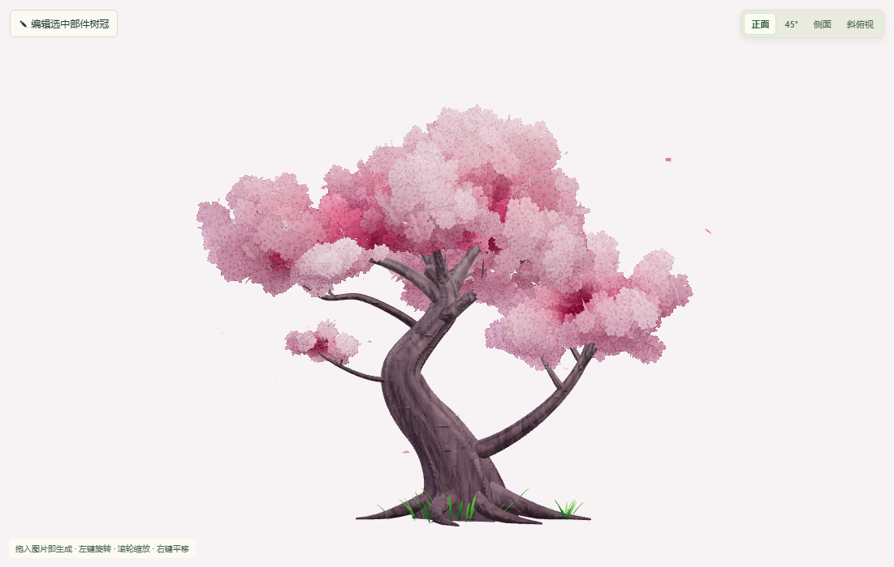
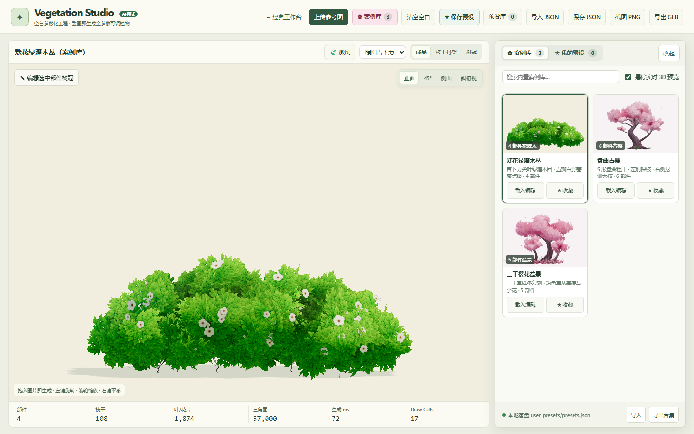
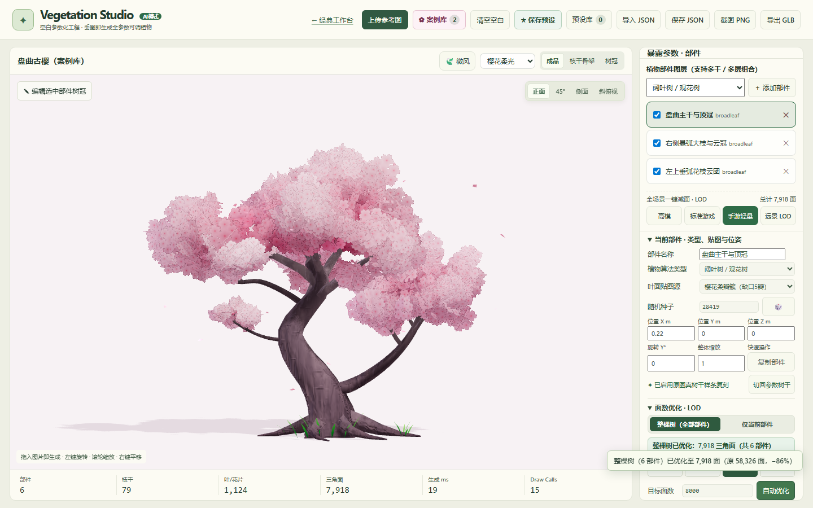

# Vegetation Studio (`foliage-mass-prototype`)

一个基于 **TypeScript + Three.js + WebGL 2 + Vite** 构建的实时程序化 3D 植被与树木创作工作台，面向游戏与风格化三维场景的植被资产生产。

支持**阔叶树、松杉针叶树、棕榈树、灌木、实体 3D 草叶、蕨类、花丛**等多品类程序化生成，内置 **SpeedTree 风格 3D 枝干节点编辑**、**AI 识图自动拆解多部件植物**、**3D 程序化树皮与抗平铺三平面贴图**、**四档/目标面数自动 LOD 减面**、**可视化预设库（悬停实时 3D 预览）**以及面向 Blender / Unity / Unreal Engine 的 **GLB 单网格多材质槽合并导出**。

---

## 效果预览

| 多树种与风格化叶型总览 | AI 案例 · 盘曲古樱 |
| :---: | :---: |
|  |  |

| SpeedTree 风格 3D 枝干节点编辑 | 案例库 · 繁花绿灌木丛 |
| :---: | :---: |
|  |  |

| AI 模式 · 多部件与整树 LOD 减面 | GLB 导出设置（合并与材质分槽） |
| :---: | :---: |
|  |  |

---

## 核心功能

### 1. 多品类程序化植被生成
- **阔叶树**：多级分叉骨架、底冠露枝负空间（`canopyLift`）、云片冠层压平（`padFlatten`）、扭棱树干与贴地露根；内置圆冠、自然分枝、樱花盆景、红枫绯秋、垂柳轻丝等预设。
- **垂柳独立算法**：专属 `drape` 垂帘下挂模式，拱肩自然过渡、垂直下垂且自动钳制离地高度不穿地。
- **针叶 / 松杉树**：低面数中脊折叠叶形面片、垂片与帐篷折叠多模式切换，顶冠收尖自然。
- **棕榈树**：带横向叶痕节环与根部膨大的弯曲/S 形树干、冠底椰果簇、三层交错下垂折叠棕榈叶。
- **低矮植物与实体 3D 草叶**：灌木、开花灌木、蕨类、以及无贴图纯几何 **实体 3D 草叶**（黄金角放射分布、弯垂弧度、横截面拱度、扭转与三色层次）。
- **花朵装饰与独立花丛模板**：支持任意植物最外层表皮自动贴合点缀花朵，以及带茎叶 / 纯花两种独立花丛模板。

### 2. SpeedTree 风格 3D 枝干节点编辑 & 树冠塑形
- **枝干节点模式**：在 3D 视口直接点选树干、一级主枝或二级侧枝，使用同心弧形 Gizmo 与 4 点 3D 样条实时拖拽长度、粗细、仰角、水平旋转与弯曲重力；父枝改动时子枝沿挂点自动联动跟随。
- **单枝控制**：支持单枝去叶、级联修剪（`Delete`）、30 步撤销（`Ctrl+Z`）与左上角实时单枝三角面 HUD。
- **树冠塑形模式**：支持可拖拽树冠包络控制点与裸枝区（Bare Zone）挖空，所有编辑操作均非破坏性且可完整序列化至 JSON / 预设库。

### 3. AI 模式（空白工程 · 丢图自动生成多部件植物）
- **零依赖内置图像解析引擎**：拖入参考图即可自动去背景、语义分割木质/叶面/根部草地、提取色板、匹配叶型，并自顶向下追踪中轴脊线复刻弯曲树干样条，自动拆解为多个独立可编辑部件。
- **复杂实景抠图画笔**：支持绿笔保留 / 红笔擦除的交互式抠图修补并一键重生成 3D。
- **整体同步 / 单体隔离双模式**：默认在整体同步模式下联动调整全树颜色、材质、光影、花朵与 LOD；进入编辑模式后解锁单部件独立参数、独立位姿与独立贴图覆写。
- **可扩展内置案例库**：内置「樱花盆景」「盘曲古樱」「繁花绿灌木丛」等实测成品案例，支持一键载入或收藏到个人预设库。

### 4. 风格化光影、3D 程序化材质与交互性能
- **风格化叶片着色器**：内置次表面背光透光（SSS）、暗部冷暖色相偏移、边缘轮廓光、垂直受光暖色阶、Alpha 扩边防白边处理与全局实时微风顶点动画；内置 4 套氛围光预设（清透画室 / 暖阳吉卜力 / 樱花柔光 / 森林冷影）。
- **全材质 3D 程序化树皮**：默认纯 GPU 对象空间域扭曲 fBM 竖向树皮与偏导凹凸法线；导入任意树皮图片时采用 **3D 三平面投影 + Voronoi 防重复抗平铺采样**，无 UV 接缝与拉伸。
- **极速交互**：纯材质/Shader 滑块 `0 ms` 零重建热更新 GPU Uniform；贴图按需懒加载。

### 5. 面数优化（LOD）、可视化预设库与 GLB 导出
- **四档 / 目标面数自动 LOD**：一键切换「高模 / 标准游戏 / 手游轻量 / 远景 LOD」，或输入目标三角面数由二分求解器自动匹配减面强度（AI 模式支持整树多部件联动预算求解）。
- **可视化预设库**：右侧非模态停靠面板，自动截取 320×220 实时 3D 封面，支持**鼠标悬停 3D 视口实时预览**、本地文件（`user-presets/presets.json`）+ `localStorage` 双通道持久化。
- **工程级 GLB 导出**：支持**整体合并为单网格多材质槽**（自动按语义命名 `Mat_Tree_Bark` / `Mat_Foliage_*` / `Mat_Flowers_*` / `Mat_Grass` 等，方便直接导入 Blender / Unity / UE）、**保留独立多部件层级**、以及**一键去除根草/花瓣等装饰网格体**。

---

## 快速开始

### 环境要求
- **Node.js** `20.19+` 或 `22.12+`
- 支持 **WebGL 2** 的现代浏览器（Chrome / Edge / Firefox）

### 安装与启动

```bash
npm install
npm run dev
```

启动后打开浏览器访问终端输出的地址（默认 `http://127.0.0.1:5867`）：

| 入口路径 | 说明 |
| --- | --- |
| `/broadleaf.html` | **经典工作台（主入口）**：全品类程序化植被、节点编辑、LOD、材质与预设库 |
| `/ai.html` | **AI 模式（空白工程）**：拖入参考图生成多部件植物、案例库、抠图画笔、整体/单体编辑 |
| `/index.html` | **早期体块原型（V1）**：松杉树冠分层体块原型 |
| `/legacy.html` | **旧版工作台**：薄片阔叶与松树对照页面 |

Windows 用户也可以直接双击或运行 `start.cmd`：

```bat
start.cmd            :: 默认启动经典工作台 (/broadleaf.html)
start.cmd ai         :: 启动 AI 模式 (/ai.html)
start.cmd sakura     :: 直达 AI 樱花盆景案例
start.cmd v1         :: 启动 V1 体块原型 (/index.html)
```

### 构建与测试

```bash
# TypeScript 类型检查 + Vite 生产构建
npm run build

# 运行 Vitest 单元测试套件（196 项）
npm test
```

> 可选：如需运行 Python Playwright 浏览器视觉自动化检查（`tests/*_browser.py`），需本地安装 Chrome 以及 Python 的 `playwright` 与 `Pillow`。

---

## 目录结构

```text
foliage-mass-prototype/
├── broadleaf.html             # 经典程序化植被工作台入口
├── ai.html                    # AI 识图多部件工作台入口
├── index.html                 # V1 树冠体块原型入口
├── legacy.html                # 旧版工作台入口
├── start.cmd                  # Windows 一键启动脚本
├── src/
│   ├── tree/                  # V2 统一程序化核心引擎
│   │   ├── spec.ts            # TreeSpec 数据结构、预设与校验
│   │   ├── envelope.ts        # 可编辑树冠包络与裸枝区
│   │   ├── skeleton.ts        # 骨架生长与非破坏性枝干节点编辑
│   │   ├── wood.ts            # 树干/分叉扫描网格、露根与圆穹封顶
│   │   ├── bark-material.ts   # 3D 程序化树皮与抗平铺三平面贴图着色器
│   │   ├── fronds.ts          # 针叶折叠片 / 垂片生成器
│   │   ├── palm.ts            # 棕榈树与椰果簇生成器
│   │   ├── ground.ts          # 实体 3D 草叶与蕨类生成器
│   │   ├── flowers.ts         # 最外层花朵点缀与飘落花瓣
│   │   ├── flowerbed.ts       # 独立花丛模板（带杆 / 纯花）
│   │   ├── optimize.ts        # 四档与目标面数自动 LOD 减面引擎
│   │   ├── textures.ts        # 内置 512×512 风格化叶型/花型程序贴图库
│   │   └── assemble.ts        # 整树装配与 0 ms 实时参数热更新
│   ├── studio/                # 工作台 UI、SpeedTree 节点编辑器、预设库、GLB 弹窗
│   ├── ai/                    # AI 图像解析、抠图画笔、多部件场景与案例库
│   ├── broadleaf/             # 叶片插片引擎、风格化 SSS/微风着色器与旧版工作台
│   ├── export-glb.ts          # glTF/GLB 导出预处理、单网格合批与材质分槽
│   └── viewport.ts            # Three.js 视口、四机位、氛围光与微风驱动
├── scripts/                   # Vite 本地预设持久化中间件 (/api/presets)
├── presets/                   # 默认 JSON 预设文件
├── public/showcases/          # AI 案例库 3D 封面缩略图
├── textures/                  # 内置占位贴图资源
├── experiments/               # 早期松杉枝叶薄片对比实验代码
├── tests/                     # Vitest 单元测试与 Playwright 浏览器验证脚本
└── docs/                      # 算法笔记与展示截图
```

---

## 延伸阅读

- [植物资产生成算法小结](docs/algorithm-notes.md)：早期松树枝叶薄片（A/B/C 方案）与阔叶多级分枝的演进记录。
