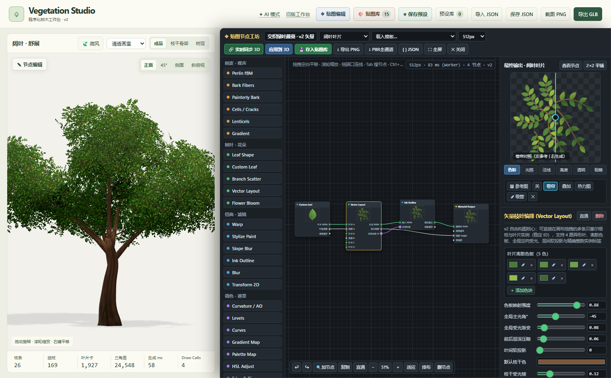

# Vegetation Studio & Rock Studio (`foliage-mass-prototype`)

> **在线体验（GitHub Pages）**：
> - **[打开经典树木工作台（主入口）](https://koerye.github.io/foliage-mass-prototype/)** — 全品类程序化植被、树干褶皱雕刻、SpeedTree 节点编辑、贴图节点工坊 v2、LOD 与 6 项 GLB 导出
> - **[打开 AI 模式（丢图生成 & 案例库）](https://koerye.github.io/foliage-mass-prototype/ai.html)** — 面向 Agent / 拖图自动拆解多部件植物、抠图画笔、案例库与整体/单体编辑
> - **[打开风格化石头工作台（Rock Studio）](https://koerye.github.io/foliage-mass-prototype/rock.html)** — 三层地质切面雕刻、厚涂 & 赛璐璐双着色风格、灰模/线框与 GLB 导出
>
> 💡 **本地运行推荐**：仓库内置了作者手调的 **14 套默认树木预设覆盖**（`user-presets/default-overrides.json`）与 **19 项程序贴图库**（`user-textures/library.json`），本地 `npm run dev` 启动后将通过 Vite 中间件自动加载并支持实时落盘保存。

一个基于 **TypeScript + Three.js + WebGL 2 + Vite** 构建的实时程序化 3D 植被与风格化石头创作工作台，面向游戏与风格化三维场景的资产生产。

---

## 效果预览

| 多树种与风格化叶型总览 | AI 案例 · 盘曲古樱 |
| :---: | :---: |
|  |  |

| 树干褶皱雕刻 & 一级枝口无缝焊接 | 贴图节点工坊 v2 · 参考图卷帘对比 & 复刻 |
| :---: | :---: |
|  |  |

| 全新 Rock Studio · 风格化石头工作台 | 6 项硬核 GLB 导出（高模法线+AO / UV1 风动） |
| :---: | :---: |
|  |  |

| SpeedTree 风格 3D 枝干节点编辑 | 案例库 · 繁花绿灌木丛 |
| :---: | :---: |
|  |  |

---

## 核心功能

### 1. 多品类程序化植被生成 & 多排布花丛
- **阔叶 / 观赏树**：多级分叉骨架、底冠露枝负空间（`canopyLift`）、云片冠层压平（`padFlatten`）、扭棱古干与贴地露根；内置圆冠、舒展、樱花盆景、红枫绯秋、垂柳轻丝、仙韵祈愿古树、绞缠枯树、扭纹古干等预设。
- **针叶 / 棕榈 / 灌木 / 实体 3D 草叶 / 蕨类**：松树低面数折叠叶形面片、带节环与椰果簇的棕榈、无贴图纯几何实体 3D 草叶。
- **独立花丛模板（带杆 / 纯花）**：带植物杆模式自带植物学 Alpha 茎叶贴图槽，支持一键切换**球形圆丘 / 方形 / 长条花带 / 环形 / 列阵**等多种分布排布。

### 2. 树干高质感褶皱雕刻 v3 & 感知 HSL 实时换色
- **树干雕刻与单流形无缝焊接**：锚定宽脊、一体连续板根、弯肘局部挤压褶皱、跨圆柱 UV 缝无缝单流形一级枝口焊接与抗混叠流场 UV；拖动雕刻/树皮参数仅原地局部重建木质几何（提速 ~8×）。
- **所见即所得感知换色**：针对彩色手绘叶贴图与自定义树皮贴图提供感知 HSL 色相映射，拉动内外叶色与树皮色调所见即所得、不发灰发脏。
- **3D 世界空间朝上青苔**：按世界法线与根沟积苔实时渲染厚涂青苔（`0 ms` GPU 实时滑块）。

### 3. SpeedTree 风格节点编辑、竖向轮廓曲线与自定义法线
- **树冠竖向轮廓曲线 & 全局枝条位移**：交互式镜像 SVG 曲线编辑器（默认 / 花瓶收腰 / 宝塔层级 / 伞盖宽顶 + 5 点实时拖拽），支持全局枝条起始高度、方位旋转与 XYZ 空间位移。
- **SpeedTree 风格枝干节点模式**：3D 视口直接点选主干/主枝/侧枝，使用金色长度柄、同心仰角弧与 4 点 3D 样条塑形，支持**拖动绿色根点沿树干上下滑动（或 `Shift+拖拽` 自由 3D 偏移）**、单枝去叶、级联修剪（`Delete`）与 30 步撤销（`Ctrl+Z`）。
- **树叶自定义法线编辑（Normal Transfer + 3D 笔刷）**：支持 6 种法线投射模式、拖拽 3D 青色投射球心、树冠表面 3D 梳向/提亮/球凸/平滑笔刷与 RGB 法线实时检视，导出 GLB 100% 保留自定义 `NORMAL`。

### 4. Substance 风格贴图节点工坊 v2 & 实时贴图库
- **独立 Web Worker 60fps 节点图引擎**：支持树皮/噪声/叶片/花朵/扭曲/曲率 AO/色板映射/描边等节点与 1:1 矢量自由构图拖拽（`Vector Layout`），支持任意 `N×M` 与 **8 区非对称橡叶图集（`Atlas Compose`）**，全通道 PBR（`BaseColor / Normal / Height / Roughness`）实时同步 3D 树木并落盘至 `user-textures/library.json`。
- **参考图对照器 & AI 自动复刻**：支持导入参考图进行**卷帘（Wipe）/ 半透明叠加 / 差异热力图 / 原像素吸管**比对，一键「✨分析初稿 → ⚡自动寻优」将参考图拆解为可编辑节点图并同步上树。

### 5. AI 模式（面向 Agent · 丢图自动生成多部件植物）
- **零依赖内置图像解析 + Agent Schema/JSON 接口**：把参考图和源码发给 DeepSeek / Codex 等 Agent 平台即可调用底层参数生成 3D 植物；也可直接将图片拖入空白画布自动拆解多部件、使用抠图画笔修补。
- **整体同步 / 单体隔离双模式 & 案例库**：默认整体同步联动调色、光影与整树 LOD；开启节点编辑后可单部件独立调参、改位姿与贴图覆写；内置成品案例库支持悬停实时 3D 预览、收藏与管理。

### 6. 全新 Rock Studio · 风格化石头工作台（`/rock.html`）
- **三层地质切面多面体裁切 + 面加权法线**：闭合凸多面体 + 跨倒角连续法线（零破缝），内置**厚涂风格化**（顶部沙/青苔/积雪覆层 + 棱角干扫）与**赛璐璐简面**（4 阶硬朗明暗 + 断续高光线）双着色模式。
- **6 套即用预设**：沙顶切面岩、赛璐璐简面石、凿面碎棱岩、宽厚平棱巨石、森林青苔磐石、自然石堆组合，支持成品 / 灰模 / 线框切换、随机石形、JSON 读写与 GLB 导出。

### 7. 内置默认预设覆盖落盘、四档 LOD 与 6 项硬核 GLB 导出
- **全状态保存替换默认预设**：树木工作台与石头工作台均支持将调好的整株状态（含全参数、9 槽 PBR 贴图、节点编辑、自定义法线与灯光）一键保存覆盖本地 `user-presets/default-overrides.json`，并可随时一键「恢复出厂」。
- **四档 / 目标面数自动 LOD**：一键切换「高模 / 标准游戏 / 手游轻量 / 远景 LOD」，或按目标三角面数二分自动压面。
- **6 项工程级 GLB 导出**：
  1. 整体合并导出（单网格多材质槽：`Mat_Tree_Bark` / `Mat_Foliage_*` 等）
  2. 不合并（保留独立多部件层级）
  3. 去除装饰类网格体（根草/磐石/飘带/落瓣等）
  4. 烘焙 3D 朝上青苔与根部阴影进顶点色 `COLOR_0`
  5. **高模雕刻树干 → 低模切线空间 Normal + Cavity AO 贴图自动烘焙**（支持 `512 / 1024 / 2048`、`OpenGL (+Y) / DirectX (-Y · UE)` 及独立 PNG 下载）
  6. **导出引擎风动权重（`UV1 / TEXCOORD_1`）**，直接接入 Blender / Unity / Unreal Engine

---

## 快速开始

### 环境要求
- **Node.js** `20.19+` 或 `22.12+`
- 支持 **WebGL 2** 的现代浏览器（Chrome / Edge / Firefox）

### 安装与启动

```bash
npm install
npm run dev
```

启动后打开浏览器访问终端输出的地址（默认 `http://127.0.0.1:5867`）：

| 入口路径 | 说明 |
| --- | --- |
| `/`（或 `/broadleaf.html`） | **经典树木工作台（主入口）**：全品类程序化植被、树干雕刻、节点/法线编辑、贴图工坊 v2、LOD 与预设库 |
| `/ai.html` | **AI 模式（空白工程）**：面向 Agent、拖入参考图生成多部件植物、案例库、抠图画笔 |
| `/rock.html` | **风格化石头工作台（Rock Studio）**：切面雕刻、厚涂 & 赛璐璐双着色风格、随机石形与 GLB 导出 |
| `/legacy.html` | **旧版工作台**：薄片阔叶与松树对照页面 |

Windows 用户也可以直接双击或运行 `start.cmd`：

```bat
start.cmd            :: 默认启动经典树木工作台
start.cmd ai         :: 启动 AI 模式 (/ai.html)
start.cmd rock       :: 启动风格化石头工作台 (/rock.html)
start.cmd sakura     :: 直达 AI 樱花盆景案例
```

### 构建与测试

```bash
# TypeScript 类型检查 + Vite 生产构建
npm run build

# 运行 Vitest 单元测试套件（21 个测试文件 / 257 项）
npm test
```

> 可选：如需运行 Python Playwright 浏览器视觉自动化检查（`tests/*_browser.py`），需本地安装 Chrome 以及 Python 的 `playwright` 与 `Pillow`。

---

## 目录结构

```text
foliage-mass-prototype/
├── index.html                 # 经典程序化树木工作台主入口
├── broadleaf.html             # 经典树木工作台兼容入口
├── ai.html                    # AI 识图多部件工作台入口
├── rock.html                  # Rock Studio 风格化石头工作台入口
├── legacy.html                # 旧版工作台入口
├── start.cmd                  # Windows 一键启动脚本
├── user-presets/              # 作者手调的 14 套默认树木预设覆盖、个人预设与隐藏案例状态
├── user-textures/             # 贴图工坊本地实时贴图库（含全通道 PBR 与 8 区橡叶图集）
├── src/
│   ├── tree/                  # 统一程序化植物核心引擎（骨架/树干雕刻/无缝焊接/感知换色/法线/花丛/LOD 等）
│   ├── rock/                  # Rock Studio 风格化石头切面雕刻与厚涂/赛璐璐着色器
│   ├── texgraph/              # Substance 风格节点贴图工坊 v2、Web Worker 求值核与参考图自动复刻引擎
│   ├── studio/                # 工作台 UI、SpeedTree 节点/法线编辑器、预设库、GLB 6 项导出弹窗
│   ├── ai/                    # AI 图像解析、抠图画笔、多部件场景与案例库
│   ├── broadleaf/             # 叶片插片引擎、风格化 SSS/微风着色器与旧版工作台
│   ├── export-glb.ts          # glTF/GLB 导出预处理、合批分槽、青苔/高模法线 AO 烘焙与 UV1 风动权重
│   └── viewport.ts            # Three.js 视口、四机位、氛围光与微风驱动
├── scripts/                   # Vite 本地持久化中间件（presets / textures）与无头贴图 CLI
├── presets/                   # 默认 JSON 预设文件
├── public/showcases/          # AI 案例库 3D 封面缩略图
├── textures/                  # 内置占位与程序化贴图资源
├── experiments/               # 早期松杉枝叶薄片对比实验代码
├── tests/                     # Vitest 单元测试（257 项）与 Playwright 浏览器验证脚本
└── docs/                      # 算法笔记与展示截图
```

---

## 延伸阅读

- [植物资产生成算法小结](docs/algorithm-notes.md)：早期松树枝叶薄片（A/B/C 方案）与阔叶多级分枝的演进记录。

---

## 许可证（License）

本项目采用 **非商业软件使用许可**（详见 [LICENSE](LICENSE)）：

- **允许**：免费下载、运行、学习、修改及非商业分发（须保留原作者版权声明与 `LICENSE` 文件）。
- **禁止**：未经作者书面授权的任何商业用途（包括集成至商业游戏/软件或付费服务）。
- **仓库权限**：本仓库仅作者本人拥有写入权限，外部访客仅可浏览与下载。
